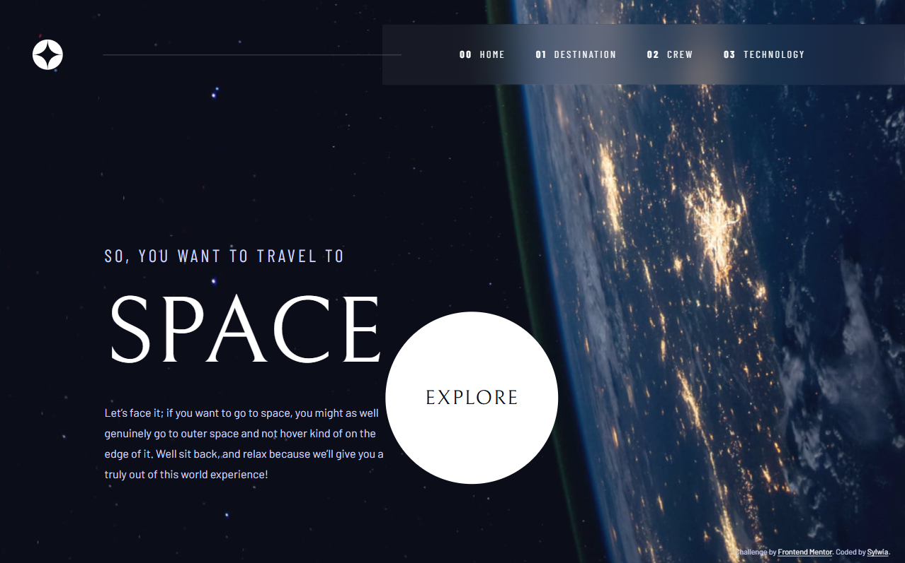
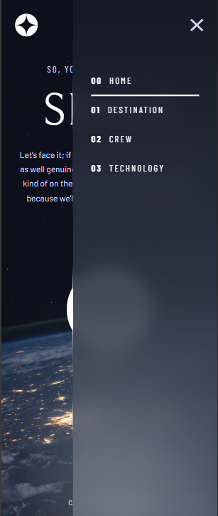

🚀 Space Tourism Website

A responsive, multi-page space tourism website built with React as part of the Frontend Mentor Space Tourism challenge.

Explore destinations across the solar system, meet the crew, and discover the technology behind space travel.

🌐 Live Demo

View Live Site — .................

📸 Screenshots

Desktop Preview

Mobile Preview

Add your screenshots to the screenshots folder using the filenames shown above.

📑 Table of Contents

Overview

Features

Built With

Project Structure

Getting Started

What I Learned

Future Improvements

Author

Acknowledgments

🌌 Overview

The Space Tourism Website is a four-page React application inspired by a Frontend Mentor design challenge. It presents a fictional space tourism experience through an immersive interface with responsive backgrounds, custom typography, and interactive content.

The layout adapts to mobile, tablet, and desktop screens.

✨ Features

Four responsive pages: Home, Destination, Crew, and Technology.

Interactive destinations: Switch between celestial destinations and view their details.

Crew selection: Explore crew members with interactive indicators.

Technology selector: Switch between space technologies using numbered controls.

Responsive navigation: Mobile menu with open and close controls.

Responsive images: Different image orientations for desktop and smaller screens.

Reusable React components: Organized page and component structure.

Accessible controls: Semantic HTML and ARIA attributes for interactive elements.

Responsive layouts: CSS Grid, Flexbox, and media queries.

🛠️ Built With

React 18

JavaScript (ES6+)

React Router

Vite

CSS3

CSS Grid and Flexbox

CSS custom properties

Google Fonts

Mobile-first responsive design

📂 Project Structure

space-tourism/
├── screenshots/
│ ├── home-desktop.png
│ └── home-mobile.png
├── src/
│ ├── assets/
│ ├── components/
│ │ └── Header/
│ ├── pages/
│ │ ├── Home/
│ │ ├── Destination/
│ │ ├── Crew/
│ │ └── Technology/
│ ├── styles/
│ │ └── global.css
│ ├── App.jsx
│ └── main.jsx
├── index.html
├── package.json
└── README.md

⚙️ Getting Started

To run the project locally, you need Node.js and npm installed.

1. Clone the repository

git clone https://github.com/sylcym/frontend-mentor-challenges.git

2. Navigate to the project directory

cd frontend-mentor-challenges/space-tourism

3. Install dependencies

npm install

4. Start the development server

npm run dev

5. Open the application

Open the local URL displayed in your terminal.

📚 What I Learned

While building this project, I practised and improved my skills in:

Building multi-page applications with React Router.

Managing interactive content with the useState hook.

Structuring React applications into components and pages.

Creating responsive layouts with CSS Grid and Flexbox.

Applying mobile-first design principles and responsive breakpoints.

Working with responsive images and CSS backgrounds.

Maintaining consistent styling with CSS custom properties.

Improving accessibility with semantic HTML and ARIA attributes.

Organizing a larger frontend project and using Git for version control.

🔮 Future Improvements

Deploy the website and add a live demo link.

Add screenshots of all four pages in desktop and mobile layouts.

Continue refining visual details against the original design.

👩‍💻 Author

Sylwia

GitHub: @sylcym

Frontend Mentor: @sylcym

🙏 Acknowledgments

Frontend Mentor for the project brief and design challenge.

The Frontend Mentor community for inspiration and learning resources.
